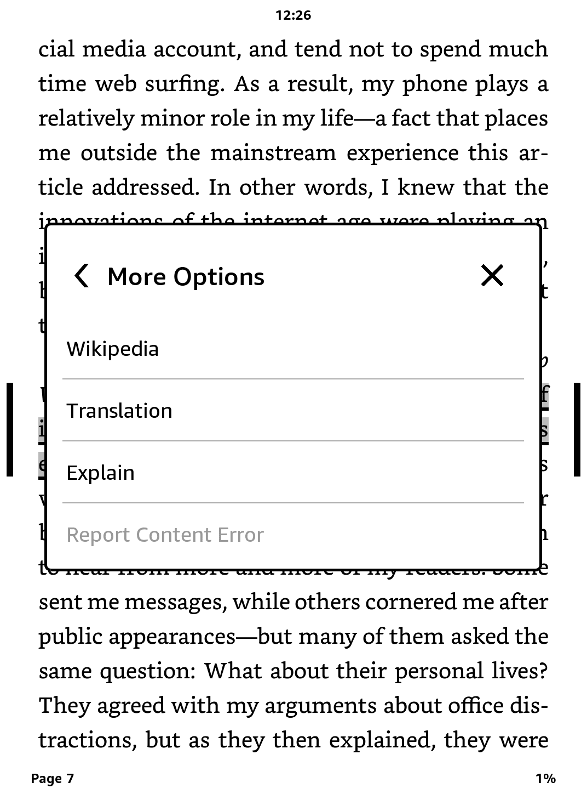

# Kindle Sentence Assistant

Explain selected text inside Kindle's stock reader. The offline setup form starts with an editable instruction for simple English explanations, idioms and missing context. Change it to request another language, translation or a different style.

[Download the experimental release](https://github.com/Edoomaan/kindle-sentence-assistant/releases/tag/v0.1.0) — choose `sentence-assistant-kual-usb-setup.zip` under Assets, not the automatically generated source-code archives.

## Screenshots

| Explain in the selection menu | Explanation inside the reader |
| --- | --- |
|  |  |

## Tested setup

| Component | Tested version |
| --- | --- |
| Device | Kindle Basic 11th generation (2024), jailbroken with KUAL |
| Firmware | `5.17.1.0.4` |
| Build | `4351960007` |
| Provider / model | Evren / `qwen3.8-flash-next` |

Explain works over Kindle Wi-Fi without a computer on this setup. Other devices and firmware versions have not been verified; automatic file/runtime checks remain in the installer.

I'm a Turkish developer, and I chose **Evren API** for development and testing. Evren is a preference, not a requirement: the app also has separate OpenAI and DeepSeek configurations, but direct requests to those providers have not been tested with live credentials.

The multi-provider plugin and earlier KUAL installer were deployed and tested on this device. The user confirmed USB settings import after the staging-ownership fix. The new single-press installation, separate backup export and fully editable instruction await device validation.

## Use

1. Press and hold one word, then lift your finger.
2. Extend the selection using its handles.
3. Choose **Explain** and wait for the explanation.
4. Choose **Close** to return to the book.

On the tested firmware, dragging directly across a sentence can create a permanent Kindle highlight. Selecting one word first and then extending the handles avoids that behavior. The assistant does not delete saved highlights.

## Privacy and API keys

Only the selected text and your saved instruction are sent to the selected provider. No surrounding paragraphs, book metadata or conversation history are included. Requests run in a background thread. Closing the card cancels the local request; stale results cannot replace a newer selection.

Keys live on the Kindle, outside USB user storage:

```text
/var/local/sentence-assistant/
  evren-header
  openai-header
  deepseek-header
  api.properties
```

The directory is mode `700`; files are mode `600`, owned by `framework`. Keys are plaintext and remain accessible to root. They are never passed as command-line arguments or written to the repository. Provider retention policies still apply to transmitted text.

## Install and configure without SSH

Normal installation and configuration use USB file transfer and KUAL. **USBNetLite and SSH are not required for this workflow.** A verified computer backup is optional but recommended; SSH remains an optional developer/recovery tool if KUAL cannot open.

1. On your computer, extract `sentence-assistant-kual-usb-setup.zip`. Open `extensions/sentence-assistant-installer/setup.html` with its adjacent `setup.js`. The form works offline.
2. Choose your provider, model ID and API key, then review the explanation instruction. Click **Create setup.properties** and place the downloaded file inside the extracted `sentence-assistant-installer` folder, next to `setup.html`.
3. Connect the Kindle and copy that entire `sentence-assistant-installer` folder into its `extensions` folder. The installer and settings file are transferred together. Safely eject USB file transfer and disconnect the cable.
4. **Optional, recommended:** before installing, use **Export backup (optional, recommended)** and save its export on your computer as described below. This optional step requires reconnecting USB; normal setup does not.
5. In KUAL, select **Install / Update** once. Wait up to two minutes for Library to return, then reopen KUAL and select **Import settings from USB**. Wait for **Settings imported** in **Show installer status** before continuing. The settings file is already on the Kindle; no second transfer is needed.
6. Import removes the Kindle transfer file and saves settings privately. Delete all computer copies of `setup.properties`, including the download and the copy placed in the extracted installer folder: they contain the key in plain text.
7. Enable Kindle Wi-Fi and choose **Test API (uses provider quota)**. After success, open a book and use Explain. Setup is complete; do not press **Install / Update** again.

**Install / Update installs the plugin; Import settings from USB only saves API settings.** Import does not add the Explain menu. If you imported settings before installing, run Install / Update once; you do not need to import again. Changing API settings after installation requires no reinstall.

**Upgrading from earlier versions:** prepare your complete instruction in the new setup form, transfer it with the installer, install the new plugin and then import settings. An old instruction such as “Use at most three short sentences” now stands alone; no hidden explanation rules are appended. Missing instructions require re-import. Leave the API key blank to reuse its saved value.

To save the optional export, wait for **Backup exported**, reconnect USB and copy `extensions/sentence-assistant/install-state/recovery-export` to a private computer folder. Run `sha256sum -c SHA256SUMS` inside that copied folder and check that all results say `OK`. Safely eject before continuing installation. Do not put backups in Kindle’s `documents` folder or publish them.

The optional export is a snapshot of the current system JAR and existing plugin, not a log archive or a full-device backup. Copy it to the computer before installation if you want an independent recovery copy. Installation always retains its own on-device transaction backup for **Restore previous version**, even if you skip export. A computer copy is restored manually through a working recovery interface; it is not restored automatically.

**Observed on the tested Kindle:** the user reported three “Application failed” messages after starting installation, followed by a working Explain menu. The cause of these messages has not been verified. Allow up to two minutes for Library to return, then check **Show installer status** and test Explain in a book. The messages alone do not establish success or failure. If Library does not return or Explain does not work, keep `extensions/sentence-assistant/install-state/installer.log` for diagnosis rather than repeatedly pressing Install / Update.

Leave the key blank to keep an existing key for the selected provider. To change providers, models or explanation preferences later, create a new `setup.properties`, copy only that file to the Kindle installer folder, safely eject and run **Import settings from USB**, then **Test API**. No reinstall or restart is needed. Delete the computer transfer file afterward. Preferences are the complete system instruction: choose the language, style and detail. The plugin adds no hidden English-only or no-translation rules. Blank instructions are rejected.

USB import succeeded on the device after the staging-ownership fix; a separate on-device API-test confirmation remains pending. The installer and earlier Explain version were tested on the target device. Direct OpenAI/DeepSeek service access remains untested. API tests may incur charges; no free tier is assumed. See [API configuration](docs/api-integration.md) and [installation/recovery](docs/installation.md) for details.

## Build and verify

The device uses a reduced Java 8 runtime. A desktop Java 8 compilation alone is insufficient. Obtain private copies of the following files from your own compatible device; do not commit or redistribute them:

- `ReaderSDK.jar`, `ReaderSDK-impl.jar`, `Reader-plugin.jar`
- `ReaderContentSDK.jar`, `Reader-utils.jar`, `reader-commons.jar`, `kafui.jar`, `json_simple-1.1.jar`
- `/usr/java/lib/rt.jar` and `/usr/java/lib/agui.jar`, in a separate runtime directory

Development checks require Python 3.8+, Node.js 18+ (offline form tests), and a JDK supporting Java 8 cross-compilation. End users need none of these tools for the packaged USB/KUAL setup. Run on the computer:

```bash
python3 -m unittest discover -s tests -p 'test_*.py'
python3 tools/build.py --check-ui
python3 tools/build.py --check-native \
  --sdk-dir /path/to/private/device-jars \
  --runtime-dir /path/to/private/runtime
python3 tools/build.py \
  --sdk-dir /path/to/private/device-jars \
  --runtime-dir /path/to/private/runtime \
  --output build/explain-preview.jar
```

`--sdk-dir` can be repeated. Build output contains only this project's classes; firmware libraries are not bundled.

## Installation and recovery

This experimental plugin supports only the verified device/firmware. Initial installation adds one registration in the system JAR; subsequent matching-registration updates replace only our plugin. KUAL offers **Restore previous version**, and the worker attempts restoration after detected installation failures. Power-loss and automatic-failure recovery are not fully device-validated; the ability to recover every failure without SSH is not guaranteed.

See [installation and recovery](docs/installation.md) for backups, package building and optional developer SSH tools. Do not publish private firmware libraries or recovery archives.

## Project layout

- `src/`: reader card, request lifecycle, provider configuration and curl transport.
- `tests/`: UI, cancellation, JSON, provider isolation and credential rotation checks.
- `kual/`: offline settings form, KUAL menus, installation and settings workers.
- `installer/`: native registration and settings import helpers.
- `tools/`: build, packaging and optional developer SSH setup commands.
- `docs/`: installation/recovery, API configuration and a concise technical evidence summary.

## Research

- [Technical findings, sources and validation limits](docs/feasibility.md)

## License

Project code is available under the [MIT License](LICENSE). Amazon software, Kindle interface elements and book excerpts visible in the screenshots are not covered by this license; their rights remain with their respective owners.
